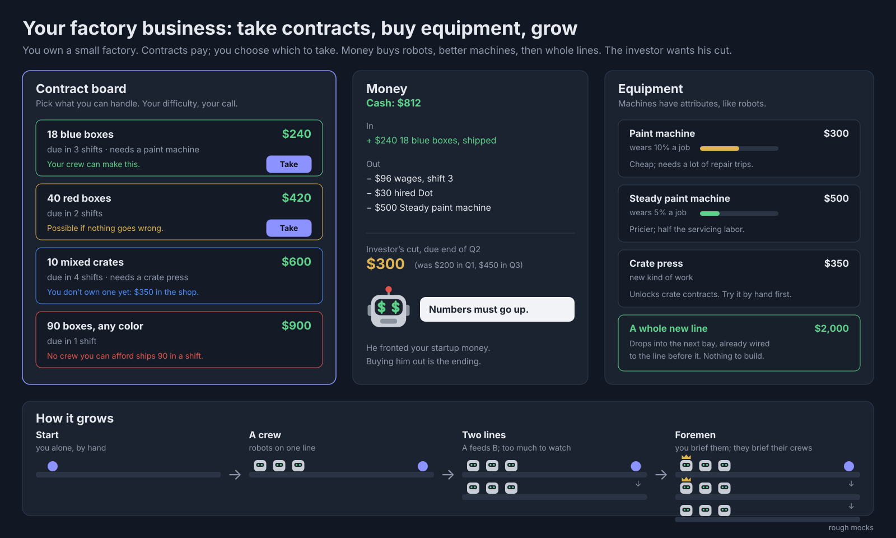

# Progression design

Status: **proposal, not agreed.** Nothing here is built. This doc is the shape of the long-term
game and stays short. Each idea in it, with detail and open questions, is an entry in
[ideas.md](ideas.md). Reasons and evidence are in [decisions.md](decisions.md). Mocks are rough and
live in [`mocks/progression/`](mocks/progression/).

## Principles

- **You never leave the floor.** At every size, the game is giving robots instructions and seeing
  what they do with them. Mike: "When it gets too managerial, it becomes a spreadsheet simulator."
- **No factory building.** New lines drop into pre-wired bays; anything flexible about routing is
  told to a foreman in words. The only thing you build is instructions.
- **You choose your difficulty** by which contracts you take.
- **Delegation comes from scale, not rules.** You can only talk to one robot at a time; a big
  enough factory makes foremen the obvious move.

## The game

You run your own small factory business. The dollar-eyed robot from the favicon is your
**investor**: he put up your starting money, and every quarter he wants a cut that keeps growing.
"Numbers must go up."

**The loop:**
1. **Take contracts** from a board: "18 blue boxes in 3 shifts, pays $240, needs a paint machine."
   Some can't be done in time with what you have.
2. **Run shifts** on the floor: hire, give instructions, watch, fix. Wages tick.
3. **Get paid** when a contract ships.
4. **Buy equipment:** a better machine (a pricier paint machine that wears half as fast saves
   repair labor), then whole lines.
5. **Pay the investor** at the end of each quarter.

**Growth.** You start alone on one small line doing the work by hand (the tutorial). Contracts pay
for robots, then machines, then a second line that turns the first one's output into something
bigger: Line A paints and boxes, Line B builds mixed crates, Line C ships. A mistake upstream
starves the line downstream.

**Foremen.** Past two lines, you can't keep up talking to every robot, so you promote one to run a
line. You brief the foreman; the foreman writes their crew's instructions, which you can read on
each robot's card. When something breaks, you trace it to what the foreman said and correct the
foreman. Same game, one more robot between your words and the work.

**The ending.** Your savings eventually buy out the investor. Final scene: you're the robot with
dollar signs for eyes, saying "Numbers must go up." Then post-game, running the company as owner.

## Biggest open questions

1. What happens when you can't pay the investor's cut?
2. What happens to a contract that's late?
3. How long until you can buy him out?

The rest are with each idea in [ideas.md](ideas.md).

## How we got here (2026-11-17)

One evening, several shapes: a corporate ladder of ranks under a robot boss (dropped: higher ranks
became a different, managerial game), then one boss and a growing factory with quotas (dropped for
contracts you choose, which are more tycoon), ending at contracts, equipment and an investor.
Decisions 38 to 47 have each step; the dropped ideas are listed with reasons at the bottom of
[ideas.md](ideas.md).
