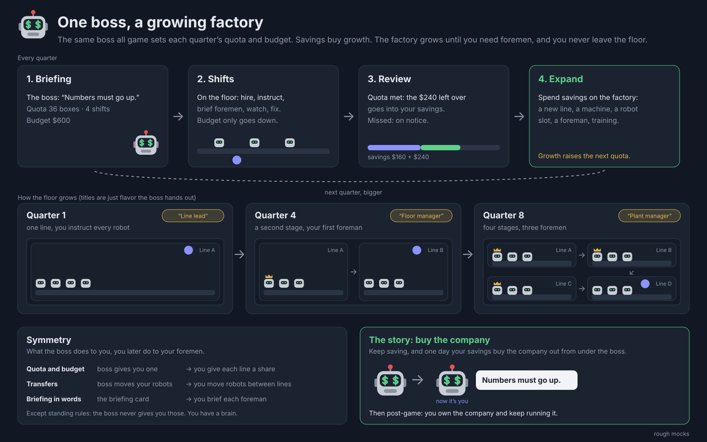
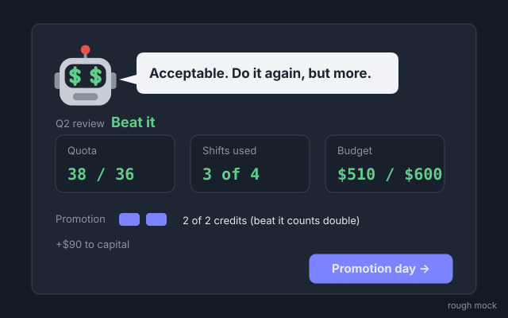
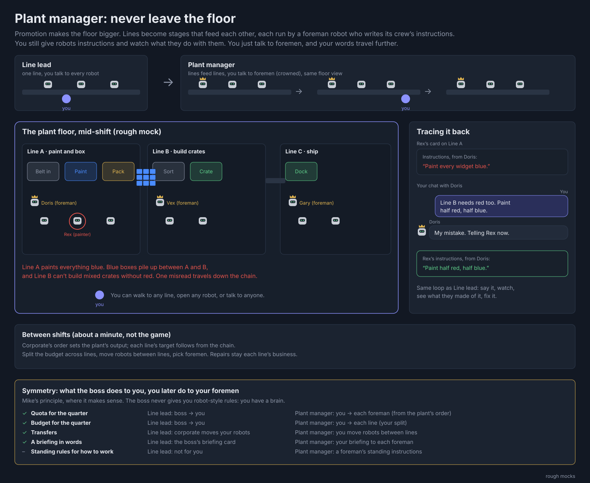

# Progression design

Status: **proposal, not agreed.** Nothing here is built. Mike decides; open questions are at the
end. Mocks are rough and live in [`mocks/progression/`](mocks/progression/). How we got here is in
[decisions.md](decisions.md) (#38 to #44).

What's agreed so far:
- The unit of play is a **quarter**: an order quota, a set number of shifts to meet it, and a
  budget (decision #35, built as the quarter sandbox).
- Labor costs money. Stars are gone. You see no revenue: quota goes up, budget goes down (#38).
- **You never leave the floor.** The game at every stage is giving robots instructions and seeing
  what they do with them. Mike: "When it gets too managerial, it becomes a spreadsheet simulator"
  (#42).
- **Symmetry:** what you do to the robots under you, the boss did to you first (#43).
- Roadmap order: words matter, the quarter sandbox, crew variety through mechanics, then
  **progression** (this doc), then disruptions (later, not core). Personalities are late polish.

---

## 1. The idea

One boss for the whole game: the dollar-eyed robot from the favicon. Every quarter they hand you a
quota, a number of shifts and a budget. "Numbers must go up." Meet the quota and the budget you
didn't spend is yours. You spend those savings on **growing the factory**: new lines that feed into
the ones you have, new machines, more robots, and foremen to run lines for you.

The factory grows until it's too big for you to run every robot yourself, so you start handing
lines to foremen, robots you promote who write their crew's instructions from what you tell them.
You're still on the floor, still talking to robots, still tracing what went wrong to whoever said
what. The game gets bigger without turning into a different game.

Mike, comparing this with the corporate-ladder draft: a factory that "just kind of grows" lends
itself more to "this kind of same type of gameplay just at a higher level", and a tycoon game wants
budgets and quotas. One boss who "stays your boss the whole game and you just keep doing bigger
stuff" gets both.

---

## 2. A quarter

1. **Briefing.** The boss's card: quota, shifts, budget, and anything new this quarter.
2. **Before each shift:** hire, let robots go, train, give instructions or briefings. Hiring stays
   between shifts only (#7).
3. **The shift** runs as it does now.
4. **Between shifts:** what shipped against the pace needed, the budget left, and anything worth
   knowing.
5. After the last shift, **the review**, then **spending your savings** on the factory.

**Quota is cumulative across the quarter.** One bad shift puts you behind pace; you fix the crew
before the next one. That answers issue #10 (one problem wrecks the run).

**Budget only goes down.** Wages, hiring fees and training come out of it. As in the sandbox, Start
waits until the budget covers the shift's payroll, so you can't overspend.

---

## 3. The review and your savings

| Result | What happens |
|---|---|
| **Quota met** | The budget you didn't spend goes into your savings |
| **Quota missed** | The leftover goes back to the company, and you're **on notice** |

Meeting quota a shift early leaves that shift's payroll unspent, so speed pays too.

**Missing twice in a row:** proposed, the boss shrinks your factory: one line is taken off you (its
robots are transferred away), and the next quota is sized to what's left. No game over in the main
mode. (Open question 1.)

**Savings buy growth.** Between quarters you spend savings in one place, the expansion list:

| Buy | What it does |
|---|---|
| **A new line** | A new stage that takes the output of one you already have (see 4) |
| **A machine** | A new kind of work on a line, tried by hand first |
| **A robot slot** | Room for one more robot on the payroll (the boss caps headcount) |
| **A foreman's badge** | Promote one of your robots to run a line |
| **Training** | Teach a robot a skill (#4) |

Growth raises the next quotas: a bigger factory is expected to ship more. So spending savings is a
real choice: grow now and take on a bigger quota, or bank it.

**Titles are flavor.** The boss gives you a new title at milestones (Line lead with your first
crew, Plant manager with your first foreman, and so on). They change nothing by themselves.

---

## 4. How the factory grows

The floor grows by adding **stages that feed each other** (Mike's idea): one line's output is the
next line's input, joined by belts you can see.

- Line A: paint widgets and box them.
- Line B: build crates from those boxes (a crate wants a mix of colors).
- Line C: ship crates.
- Later stages: whatever comes next, each with a new machine you try by hand first.

The order is the plant's final product (crates, say), and each line's target follows from the
chain. Because lines are joined, a mistake travels: Line A paints too much blue, and twenty seconds
later Line B is starved of red, with blue boxes piling up on the belt between them.

### Foremen

Once there's more floor than you can run yourself, you promote a robot to foreman of a line. You
talk to the foreman, and the foreman writes instructions for their crew. Those instructions sit on
the crew's cards like always, so you can open any robot and see what it was told and by whom. You
can still walk to any line and talk to any robot.

What you do with a foreman is the same game one level up:
- **Brief them:** "Line B needs 12 mixed crates this shift; red is short, so build the all-blue
  ones first."
- **Watch it play out** across lines.
- **Debug second-hand:** open the robot that went wrong, read what its foreman told it, and fix it
  by talking to the foreman.
- **Foremen come to your desk** when their line is starved, flooded or behind, the way workers do.
- Each foreman keeps **standing instructions** for how they manage ("tell me early when the quota's
  at risk"). When you correct a foreman, the correction can become one of these, so the same mistake
  doesn't come back.

### A foreman shift, step by step

Mike: "once you get to the point where you are giving instructions to people that give
instructions, like what is actually the point of that going to be and what is that going to look
like concretely?"

You run three lines. Doris is foreman of Line A, which paints and boxes. Vex is foreman of Line B,
which builds crates that need half red and half blue boxes.

1. **You brief Doris** before the shift: "Line B needs mixed crates, half red and half blue. Keep
   blue coming, we were short on it last shift." One message instead of five robot cards.
2. **Doris writes her crew's cards** in her own words. Pip: "Carry widgets from the belt to
   Paint." Rex: "Paint every widget blue." She heard "keep blue coming" louder than "half red".
3. **It goes wrong downstream.** Mid-shift, blue boxes pile up on the belt into Line B and no red
   arrives. Vex comes to your desk: "No red boxes for 40 seconds. I can't build a single crate."
4. **You trace it back.** Line B is starved, Line A sends only blue, Rex paints everything, and
   Rex's card says "Paint every widget blue", from Doris. Rex did what he was told. The mistake is
   in what Doris told him, and under that, in what you told Doris.
5. **You fix it through Doris:** "Half the widgets stay red. Only paint enough for the blue half."
   She rewrites Rex's card, and her standing instructions gain "check the mix the next line needs
   before painting", so it doesn't come back.

**Why foremen are worth it:**
- **Reach.** You can't write 30 robots' cards every shift. One briefing sets up a whole line.
- **Surprises.** Mid-shift, Doris handles her own line's problems without you, the way workers
  think on their own now.
- **A new skill.** The game becomes saying what you mean so it survives being retold, and finding
  where it didn't. Same game as writing a robot's instructions, with one more robot in the way.

**Splitting quotas and budgets.** With several foremen, you hand each line its share of the quota
and budget between shifts, the same way the boss hands them to you. It takes a minute and isn't
where the game is. Repairs stay each line's business.

### Symmetry

| What | The boss does it to you | You do it to a foreman |
|---|---|---|
| Quota for the quarter | yes | each line's share |
| Budget for the quarter | yes | each line's share |
| Transfers | the boss moves robots off your floor and sends you new ones | you move robots between lines |
| A briefing in words | the briefing card | your briefing to each foreman |
| Standing rules for how to work | no: you have a brain | a foreman's standing instructions |

Transfers from the boss start early, while you still have one line, so robots moving around is
familiar before you're the one moving them.

---

## 5. The story: buy the company, then run it

The tycoon payoff is the ending, not a rank you play. You start as hired help under the
dollar-eyed boss and keep growing the factory. One day your savings are enough to buy the company
out from under the boss. Final scene: you're the robot with dollar signs for eyes, saying "Numbers must
go up." (Mike: "I really love that final scene.") Tracked in issue #14.

**Post-game:** you keep running the company as its owner. Ideas, not decided:
- An endless mode: quarters keep coming, and the quotas are ones you set (or a board sets).
- Hire a robot as line lead for a new factory and give them quotas and budgets, the way the boss
  did to you. Symmetry, all the way up.
- Expand into new products that need new stages.

---

## 6. Your robots grow too (#4, #5)

- **Experience** comes from shifts worked and shows on the card.
- **Training** costs money and adds a skill. Experience makes it cheaper.
- **A foreman** gets a raise. What makes a good one is a mechanic: Smart (a bigger thinking budget)
  matters most, because a foreman's work is thinking.
- Passing over someone who earned it hurts morale (#5), not designed here.

---

## 7. How difficulty ramps

| Dial | Early | Later |
|---|---|---|
| Quota | small, growing each quarter | grows with every expansion |
| Order mix | one color, then two or three | crates that need a mix from several lines |
| Machines | one new one at a time | a new stage brings its own |
| Budget | generous | tight, split across lines by you |
| Stages | 1 | 3 to 5, feeding each other |
| Robots you're responsible for | 2 to 5 | 15 to 30, most of them through foremen |

The ramp comes from your attention running out: each expansion makes the way you played before
stop working, until delegating to foremen isn't optional. Disruptions come later, landing at the
briefing or between shifts where you can plan around them.

Cost: robots on lines you aren't watching still run their compiled programs, which cost no model
calls. Foremen think when their line hits trouble, like any worker. A cheaper simulation for far
away lines is an implementation question for later.

---

## 8. Open questions for Mike

1. **Failure:** missing twice shrinks the factory (proposed), or something else? Is there ever a
   game over?
2. **The tutorial:** is it your first week, with the boss as your boss from the start?
3. **What savings buy:** is the list above right? Should growth ever be forced (the boss expands
   you whether you like it or not)?
4. **Quota counting:** boxes shipped of any kind, or every order filled exactly?
5. **Foremen:** any robot, or only one with experience? Do they still work the line?
6. **Going around a foreman:** is telling a crew robot something directly free, or does the foreman
   mind?
7. **What the stages make** after crates.
8. **The boss:** do they have a name?
9. **Length:** how many quarters from one line to buying the company?
10. **Post-game:** which of the ideas in section 5?
