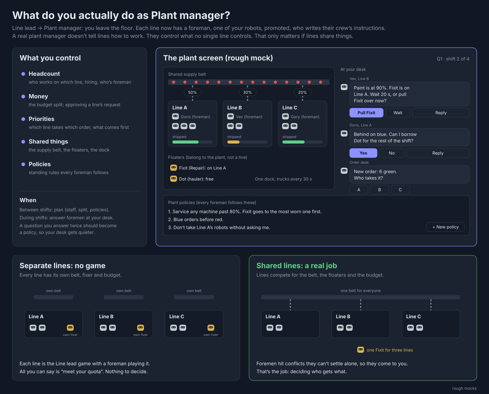

# Progression design

Status: **proposal, not agreed.** Nothing here is built. Mike decides; open questions are collected
at the end. Mocks are rough and live in [`mocks/progression/`](mocks/progression/).

What's already agreed (from the coordinator thread and decisions #7, #25):
- The unit of play is a **quarter**: an order quota, a set number of shifts to meet it, and a
  starting budget.
- Labor costs money. Stars are gone; quotas and promotions replace them.
- Roadmap order: words matter, the quarter sandbox (both in progress), crew variety through
  mechanics, then **progression** (this doc), then disruptions (later, not core). Personalities are
  late polish; this doc is about mechanics.

The shape this doc proposes is Mike's "corporate ladder" from issue #3: a robot boss gives you a
quota, you hit it, you get promoted into a bigger job, and the job changes what you do all day.
Mike's twist on it: you buy the promotion with the budget you didn't spend. The roguelike and the
continuous business are compared in "Alternatives" at the end.

---

## 1. The idea in one paragraph

Your boss is the dollar-eyed robot from the favicon. Every quarter they hand you a quota, a number
of shifts and a budget. You staff your floor, write instructions, run the shifts, and at the end the
boss reviews you. Hit quota and you keep your job; whatever budget you didn't spend is yours, and
you save it up to buy your promotion from the boss. Each promotion gives you
more floor than you can personally watch, so the only way to keep hitting quota is to put people
you've developed in charge of parts of it. By the top of the ladder you mostly talk to managers,
and the robots you hired in your first quarter are running lines for you.

The difficulty ramp comes from **your attention running out**, more than from harder numbers.
Each rank's quotas are sized so that the way you played the previous rank stops working.

---

## 2. A quarter, step by step

1. **Briefing.** The boss's card: quota (e.g. 36 boxes, any mix the orders call for), shifts (4),
   budget ($600). Plus anything new this quarter: a new machine, a new product, a bigger floor.
2. **Before each shift:** hire and let people go, train, buy, write and adjust instructions.
   Hiring stays between shifts only (decision #7).
3. **The shift** runs as it does now: orders arrive, the crew works them, wages tick.
4. **Shift report.** Shipped against the pace needed, the budget left, and anything
   worth knowing (a machine that sat worn out for 40 s, a worker who came to your desk three times).
5. After the last shift, **the review.**

**Quota is cumulative across the quarter.** One bad shift doesn't fail you; it puts you behind pace,
and you fix the crew before the next one. This is the main answer to issue #10 (one problem wrecks
the run): a shift going wrong becomes something you recover from between shifts.

### Money inside a quarter

- **Budget** is what the boss gives you for the quarter, and it only goes down. Wages, hiring fees,
  training and purchases come out of it. A line lead doesn't see sales or revenue: the money a box
  makes is the company's business, not yours (Mike: a line manager worrying about money earned by
  selling "doesn't really make sense"). Quota is the number that goes up; budget is the one that
  goes down.
- As in the quarter sandbox (decision #35), Start waits until the budget covers the shift's payroll,
  so you can't overspend. Running short means a smaller crew, not debt.
- **Money left over is yours, and it buys your promotion.** When a quarter ends with the quota met,
  the unspent budget goes into your savings. A promotion has a price, and you buy it from the boss
  once you can afford it (Mike: "you use your money to buy a promotion"). So running lean is how
  you climb: every robot you didn't need is money toward the next rank. It also fits the dollar-eyed
  boss. (An earlier idea, spending it on your own little house, was dropped for this.)

---

## 3. The review, and failure

Each quarter ends one of two ways:

| Result | What happens |
|---|---|
| **Quota met** | The budget you didn't spend goes into your savings |
| **Quota missed** | The leftover goes back to the company, and you're **on notice** |

There are no grades beyond that, because the money already says how well you did. Meeting quota a
shift early leaves that shift's payroll unspent, so speed pays too.

**Promotion** has a price at each rank, and you buy it from the boss between quarters once your
savings cover it. Prices are set so a lean quarter or two gets you there at the lower ranks and it
takes longer higher up (Mike: "keep the lower stages short"). Buying it spends the savings, so you
start the new rank at zero.

**Failure:**
- Missed once: on notice. The next quarter's quota stays the same instead of growing, and the boss
  says so.
- Missed twice in a row: **demoted** one rank. You keep your crew; you lose the
  rank's unlocks until you earn it back. At the bottom rank there's nowhere to fall, so you replay
  the quarter.
- No game over in the main mode. Getting fired (a run ending) is the roguelike variant's failure,
  if we make one. (Open question 1.)

The boss reacts in a few fixed lines (deterministic, no model calls, per #3). Comedy lives in their
voice: the dollar eyes, the corporate phrasing.

---

## 4. What carries between quarters

| Carries | Doesn't |
|---|---|
| Your crew: every worker, their skills, attributes, wage, experience | The budget (each quarter gets a fresh one; leftovers are open question 3) |
| Each worker's instructions, as written on their card | Orders in progress (the quarter closes them out) |
| The floor: machines, layout, stations you bought | The shift clock |
| Your rank and your savings | |
| Who runs what (foremen, managers) | |

Carrying instructions matters: quarter two should start with a working floor you tune, not a blank
one. A new quarter's briefing points at what will break ("new this quarter: blue widgets") so you
know which cards to revisit.

---

## 5. The ladder

Each rank says what you do, what's new, and why the previous way of playing stops working.

### Rank 0: Floor hand (the current tutorial)
- **You:** do the work by hand under the boss's instructions.
- **This is the tutorial levels**, reframed as your first week. You learn every machine by hand
  (that principle stays). No budget.
- **Promotion:** finish the tutorial.

### Rank 1: Line lead
- **You:** run one line. Hire 2 to 4 robots, write their instructions, still walk the floor and
  step in by hand.
- **Quarters:** 3 shifts. Small quotas, generous budgets.
- **Unlocks during the rank:** new machines arrive one at a time, each used by hand first. Later in
  the rank, **training** (pay to teach a worker a skill, #4) and **foremen**: you can make one of
  your workers foreman of your line. You tell the foreman what the line has to do; the foreman
  writes the instructions for the others, and they show up on those robots' cards. The foreman is
  still a robot on the floor and still does work. You're still there too, so it's delegation with
  you watching, which is the practice you need before you leave the floor.
- **Why foremen fit:** the worker design already has the pieces. A foreman is a worker whose
  instructions are about other workers' instructions, and decision #19 parked worker-to-worker
  messages for exactly this.
- **Why it stops working:** the next rank needs several lines' worth of output, and you can only
  stand on one.

(A Shift supervisor rank, two lines on one floor, sat between these two in the first draft. Mike
cut it: "this kind of feels like it shouldn't exist.")

### Rank 2: Plant manager

You run a plant of lines, starting with 2 (your old line, under the foreman you left in charge,
plus a new one) and growing to 3 to 5. You don't walk the floor anymore. Each line has a foreman,
one of your robots, promoted.

#### What a plant manager does in real life

Mike's challenge: "what would you even do other than say hey make sure you meet your quota and
yell at them when they aren't, but what can you really do to control that?" A real plant manager
doesn't tell lines how to do the work. They control things no single line controls:

- **Headcount.** Who works on which line, hiring, moving people, who's foreman.
- **Money.** How the budget splits between lines; approving a line's request for more.
- **Priorities.** Which orders go to which line, and what comes first when two lines want the
  same thing.
- **Shared resources.** The things every line uses and there isn't enough of: the incoming
  supply, the maintenance crew, the dock.
- **Standing policies.** Rules every foreman follows without asking ("service any machine past
  80%", "blue orders before red"), so the same question doesn't come back every shift.

#### Lines have to share things, or there's no game

If every line has its own belt, its own repair robot and its own budget, each line is just the Line
lead game with a foreman playing it, and your only job really is "meet your quota". The rank only
works if lines **compete for scarce shared things**, so foremen run into conflicts they can't settle
on their own:

- **One supply belt** feeds the whole plant, and you set how it splits between lines.
- **Floaters**: a small pool of robots that belong to the plant, not a line (a repair robot, a
  spare hauler). One floater, three lines that want it.
- **One dock** with trucks on a schedule.
- **One budget**, split by you.

Those conflicts are what foremen bring to your desk:

- "Paint on Line B is at 90%. The repair robot is on Line A. Wait 20 s, or pull it over?"
- "We're behind on blue. Can I borrow C's hauler for this shift?"
- "A new order for 6 green came in. Who takes it?"
- "Pip keeps standing around. Replace him?"

#### How you play it

- **Between shifts (plan):** split the budget, move robots between lines, decide which lines get
  which orders, set the belt split, and write **policies**.
- **During shifts (respond):** foremen come to your desk with conflicts. You answer in a word or a
  sentence, or click one of the options they offer. Anything you answer twice is a sign it should
  have been a policy.
- **Policies are instructions one level up.** At Line lead you wrote instructions for a robot's
  task. Here you write rules for the whole plant, and foremen apply them. A good set of policies
  means a quiet desk. A foreman can still misread a policy, and you see it in what they do.
- **Drop in** to any line to watch it or talk to a robot directly, as an escape hatch.
- Later in the rank, **managers** (a step above foremen) can hire and fire for their lines within
  the budget you give them.

Token cost stays low: lines run as plain sim, and the model only runs when a foreman decides
something needs you, when you talk, and for policies being read.

(This replaces the four options A to D posted earlier. Live escalations (A), planning between
shifts (B) and instructions one level up (C) are all in it; designing the plant (D) is not.)

#### Open questions for Plant manager

- Which shared things to start with. Floaters and the belt split are the cheapest to build on the
  current sim; a shared dock needs trucks on a schedule.
- Does time pause while a foreman waits at your desk, or does their line lose time?
- Do foremen offer you options to click, or do you always answer in words?

### Rank 3: Director (top of the core ladder)
- **You:** several plants, each run by a plant manager. You're your old boss now.
- **New:** you set quotas and budgets for your plant managers, the way the boss set them for you.
- **Endgame:** the business side (#8: investors, competitors) would hang off this rank. Out of scope
  for the core game.

### When you're promoted, someone takes your old job

This is the thread that ties the ladder together. Promotion day asks who runs the line you're
leaving. If you've developed a worker who can, they take it, and that line becomes the first row of
your new view. If you haven't, the boss puts in a stock hire, cheaper and worse. So developing your
people pays off at the exact moment you rise, and the crew from your first quarter can still be
working for you at the top.

---

## 6. Your workers grow too (#4, #5)

- **Experience** comes from shifts worked. It shows on the card.
- **Training** costs money and time (the worker misses a shift) and adds a skill. Experience makes
  training cheaper, so the robot who has watched the paint machine for three quarters learns
  Painting for less.
- **Promoting a worker** (to foreman, then manager) raises their wage. Passing over someone who has
  earned it hurts morale (#5), which isn't designed here.
- **What makes a good foreman** is a mechanic, not a personality: Smart (a bigger thinking budget)
  matters most, because a foreman's work is thinking. (Open question 6.)

---

## 7. How difficulty ramps

Five dials. Each rank turns some of them, one new thing at a time:

| Dial | Line lead | Plant manager |
|---|---|---|
| Quota per shift | small, growing each quarter | 2x at first, about 5x by the end |
| Order mix | one color, then two or three | several products |
| New machines | one per quarter | a new line type, then the line types you choose |
| Budget | generous | tight, split by you |
| Span (robots you're responsible for) | 2 to 5 | 8 at first, 15 to 30 by the end |

Within a rank, each quarter's quota grows a bit over the last (unless you're on notice). Budget grows
more slowly, so the same crew gets tighter and you have to get smarter.

Disruptions (supply delays, rush orders, a key worker out sick) are a later dial, per the roadmap.
When they come, they should land at the briefing or between shifts, where you can plan around them,
following the no-random-breakdowns principle.

---

## 8. Alternatives considered

- **Roguelike (#3 comment):** each run is a ladder climb; missing twice ends the run. After each
  shift you pick 1 of 3 new hires. Shorter, replayable, and fits the hire-picks idea. Costs: crew
  you've grown for hours is lost, which fights the "develop your people" core. Could be a separate
  mode built on the same quarters.
- **Continuous business (#3):** no ranks, the company just grows. Has no built-in reason for the
  game to change shape, which the ladder gives for free.
- **Repeatable levels to grind (#3):** close to this doc if each rank's quarters were replayable.
  Grinding was rejected for the tutorial (#7); here it's avoided because quotas grow.

---

## 9. Open questions for Mike

1. **Failure:** demotion with no game over (proposed), or getting fired ends the run?
2. **Rank 0:** is the tutorial reframed as "your first week as a floor hand", or kept separate?
   Does being a worker under a robot boss stay that short?
3. **Savings:** leftover budget buys your promotion (agreed). Open: can savings buy anything else
   (training, a machine), or only the promotion? If both, every purchase delays your promotion,
   which is an interesting choice but might make training feel like a trap.
4. **Demotion and savings:** do you keep your savings when demoted? Keeping them makes the climb
   back quick.
5. **Quota counting:** does quota count boxes shipped of any kind, or must every order in the
   quarter be filled? (The second makes order mix matter more.)
6. **Foremen:** can any worker be promoted, or only one with enough experience? Does a foreman keep
   working the line, or only manage?
7. **The plant view:** is dropping into a line free, or does it cost something (time keeps running
   at full speed everywhere else)?
8. **The boss:** do they have a name? Do they ever get promoted away and replaced?
9. **Length:** about how long should a run from Line lead to Director take? This sets the number of
   quarters per rank.
