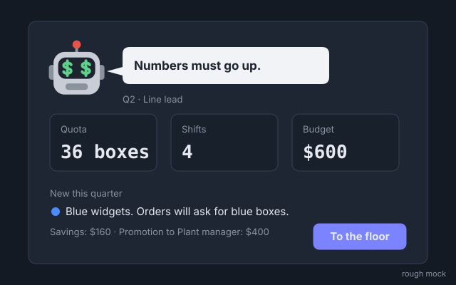
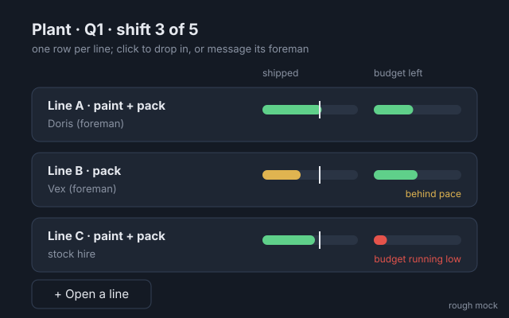

# Progression design

Status: **proposal, not agreed.** Nothing here is built. Mike decides; open questions are collected
at the end. Mocks are rough and live in [`mocks/progression/`](mocks/progression/).

What's already agreed (from the coordinator thread and decisions #7, #25):
- The unit of play is a **quarter**: an order quota, a set number of shifts to meet it, and a
  starting budget.
- Labor costs money. Stars are gone; quotas and promotions replace them.
- Roadmap order: words matter, the quarter sandbox (both in progress), crew variety through
  mechanics, then **progression** (this doc), then disruptions (later, not core). Personalities are
  late polish; this doc is about mechanics.

The shape this doc proposes is Mike's "corporate ladder" from issue #3: a robot boss gives you a
quota, you hit it, you get promoted into a bigger job, and the job changes what you do all day.
The roguelike and the continuous business are compared in "Alternatives" at the end.

---

## 1. The idea in one paragraph

Your boss is the dollar-eyed robot from the favicon. Every quarter they hand you a quota, a number
of shifts and a budget. You staff your floor, write instructions, run the shifts, and at the end the
boss reviews you. Hit quota under budget and you move toward a promotion. Each promotion gives you
more floor than you can personally watch, so the only way to keep hitting quota is to put people
you've developed in charge of parts of it. By the top of the ladder you mostly talk to managers,
and the robots you hired in your first quarter are running lines for you.

The difficulty ramp comes from **your attention running out**, more than from harder numbers.
Each rank's quotas are sized so that the way you played the previous rank stops working.

---

## 2. A quarter, step by step

1. **Briefing.** The boss's card: quota (e.g. 36 boxes, any mix the orders call for), shifts (4),
   budget ($600). Plus anything new this quarter: a new machine, a new product, a bigger floor.
2. **Before each shift:** hire and let people go, train, buy, write and adjust instructions.
   Hiring stays between shifts only (decision #7).
3. **The shift** runs as it does now: orders arrive, the crew works them, wages tick.
4. **Shift report.** Shipped against the pace needed, the budget left, and anything
   worth knowing (a machine that sat worn out for 40 s, a worker who came to your desk three times).
5. After the last shift, **the review.**

**Quota is cumulative across the quarter.** One bad shift doesn't fail you; it puts you behind pace,
and you fix the crew before the next one. This is the main answer to issue #10 (one problem wrecks
the run): a shift going wrong becomes something you recover from between shifts.

### Money inside a quarter

- **Budget** is what the boss gives you for the quarter, and it only goes down. Wages, hiring fees,
  training and purchases come out of it. A line lead doesn't see sales or revenue: the money a box
  makes is the company's business, not yours (Mike: a line manager worrying about money earned by
  selling "doesn't really make sense"). Quota is the number that goes up; budget is the one that
  goes down.
- As in the quarter sandbox (decision #35), Start waits until the budget covers the shift's payroll,
  so you can't overspend. Running short means a smaller crew, not debt.
- **What happens to money left over** is undecided (open question 3). Mike's idea: it goes to you,
  and you spend it on your own little house that you see between shifts. That makes running lean
  pay off for you personally, separate from the floor.

---

## 3. The review, and failure

Each quarter ends with one of three grades:

| Grade | When | What happens |
|---|---|---|
| **Beat it** | Quota met with a shift to spare, or with at least 20% of the budget left | Counts double toward promotion |
| **Met** | Quota met | Counts toward promotion |
| **Missed** | Quota short | You're **on notice** |

**Promotion** comes after a set number of credits at your rank: 2 at Line lead, 3 at Supervisor,
4 at Plant manager. Beat-it quarters get you there faster. Lower ranks are short on purpose
(Mike: "keep the lower stages short").

**Failure:**
- Missed once: on notice. The next quarter's quota stays the same instead of growing, and the boss
  says so.
- Missed twice in a row: **demoted** one rank. You keep your crew; you lose the
  rank's unlocks until you earn it back. At the bottom rank there's nowhere to fall, so you replay
  the quarter.
- No game over in the main mode. Getting fired (a run ending) is the roguelike variant's failure,
  if we make one. (Open question 1.)

The boss reacts in a few fixed lines (deterministic, no model calls, per #3). Comedy lives in their
voice: the dollar eyes, the corporate phrasing.

---

## 4. What carries between quarters

| Carries | Doesn't |
|---|---|
| Your crew: every worker, their skills, attributes, wage, experience | The budget (each quarter gets a fresh one; leftovers are open question 3) |
| Each worker's instructions, as written on their card | Orders in progress (the quarter closes them out) |
| The floor: machines, layout, stations you bought | The shift clock |
| Your rank and promotion credits | |
| Who runs what (foremen, managers) | |

Carrying instructions matters: quarter two should start with a working floor you tune, not a blank
one. A new quarter's briefing points at what will break ("new this quarter: blue widgets") so you
know which cards to revisit.

---

## 5. The ladder

Each rank says what you do, what's new, and why the previous way of playing stops working.

### Rank 0: Floor hand (the current tutorial)
- **You:** do the work by hand under the boss's instructions.
- **This is the tutorial levels**, reframed as your first week. You learn every machine by hand
  (that principle stays). No budget.
- **Promotion:** finish the tutorial.

### Rank 1: Line lead
- **You:** run one line. Hire 2 to 4 robots, write their instructions, still walk the floor and
  step in by hand.
- **Quarters:** 3 shifts. Small quotas, generous budgets.
- **Unlocks during the rank:** new machines arrive one at a time, each used by hand first.
- **Why it stops working:** the next rank's quotas need two lines' worth of output.

### Rank 2: Shift supervisor
- **You:** two lines on one floor, up to about 8 robots. You can't be at both lines.
- **New:** **training** (pay to teach a worker a skill, #4) and **foremen**. You promote one of your
  workers to foreman of a line. You tell the foreman what the line has to do; the foreman writes
  the instructions for the robots on that line, and they show up on those robots' cards. The foreman
  is still a robot on the floor and still does work.
- **Why foremen work here:** the worker design already has the pieces. A foreman is a worker whose
  instructions are about other workers' instructions, and decision #19 parked worker-to-worker
  messages for exactly this.
- **Why it stops working:** at the next rank you leave the floor.

### Rank 3: Plant manager
- **You:** a plant of 3 to 5 lines. You don't walk the floor anymore. Your screen is the plant view:
  one row per line, its foreman, its pace and its budget left. Click a line to drop in and watch it, or
  open a chat with anyone there.
- **New:** **managers**, a step above foremen, who can hire and fire for their lines within a budget
  you give them. You split the quarter's budget across lines.
- **The skill now:** judging people by results and by what they tell you, and deciding who gets
  which line. Issue #6's question "do you stop seeing a line's floor once a manager runs it?"
  gets the answer: you can still see it, but nothing pulls you there unless something goes wrong.
- **Token cost:** lines you aren't looking at run as plain sim. The model only runs for the
  conversations you start, and for thinking that workers and managers would do anyway (#3).

### Rank 4: Director (top of the core ladder)
- **You:** several plants, each run by a plant manager. You're your old boss now.
- **New:** you set quotas and budgets for your plant managers, the way the boss set them for you.
- **Endgame:** the business side (#8: investors, competitors) would hang off this rank. Out of scope
  for the core game.

### When you're promoted, someone takes your old job

This is the thread that ties the ladder together. Promotion day asks who runs the line you're
leaving. If you've developed a worker who can, they take it, and that line becomes the first row of
your new view. If you haven't, the boss puts in a stock hire, cheaper and worse. So developing your
people pays off at the exact moment you rise, and the crew from your first quarter can still be
working for you at the top.

---

## 6. Your workers grow too (#4, #5)

- **Experience** comes from shifts worked. It shows on the card.
- **Training** costs money and time (the worker misses a shift) and adds a skill. Experience makes
  training cheaper, so the robot who has watched the paint machine for three quarters learns
  Painting for less.
- **Promoting a worker** (to foreman, then manager) raises their wage. Passing over someone who has
  earned it hurts morale (#5), which isn't designed here.
- **What makes a good foreman** is a mechanic, not a personality: Smart (a bigger thinking budget)
  matters most, because a foreman's work is thinking. (Open question 6.)

---

## 7. How difficulty ramps

Five dials. Each rank turns some of them, one new thing at a time:

| Dial | Line lead | Supervisor | Plant manager |
|---|---|---|---|
| Quota per shift | small | about 2x | about 5x |
| Order mix | one color, then two | 2 to 3 colors | several products |
| New machines | one per quarter | a new line type | the line types you choose |
| Budget | generous | normal | tight, split by you |
| Span (robots you're responsible for) | 2 to 4 | about 8 | 15 to 30 |

Within a rank, each quarter's quota grows a bit over the last (unless you're on notice). Budget grows
more slowly, so the same crew gets tighter and you have to get smarter.

Disruptions (supply delays, rush orders, a key worker out sick) are a later dial, per the roadmap.
When they come, they should land at the briefing or between shifts, where you can plan around them,
following the no-random-breakdowns principle.

---

## 8. Alternatives considered

- **Roguelike (#3 comment):** each run is a ladder climb; missing twice ends the run. After each
  shift you pick 1 of 3 new hires. Shorter, replayable, and fits the hire-picks idea. Costs: crew
  you've grown for hours is lost, which fights the "develop your people" core. Could be a separate
  mode built on the same quarters.
- **Continuous business (#3):** no ranks, the company just grows. Has no built-in reason for the
  game to change shape, which the ladder gives for free.
- **Repeatable levels to grind (#3):** close to this doc if each rank's quarters were replayable.
  Grinding was rejected for the tutorial (#7); here it's avoided because quotas grow.

---

## 9. Open questions for Mike

1. **Failure:** demotion with no game over (proposed), or getting fired ends the run?
2. **Rank 0:** is the tutorial reframed as "your first week as a floor hand", or kept separate?
   Does being a worker under a robot boss stay that short?
3. **Leftover budget:** parked for later. Mike's lead: it goes to you, to spend on your own little
   house that you see between shifts. Open: what the house buys you (looks only, or something
   that helps on the floor), and whether the boss takes a cut.
4. **Grades:** three grades (beat / met / missed) or just pass and fail?
5. **Quota counting:** does quota count boxes shipped of any kind, or must every order in the
   quarter be filled? (The second makes order mix matter more.)
6. **Foremen:** can any worker be promoted, or only one with enough experience? Does a foreman keep
   working the line, or only manage?
7. **The plant view:** is dropping into a line free, or does it cost something (time keeps running
   at full speed everywhere else)?
8. **The boss:** do they have a name? Do they ever get promoted away and replaced?
9. **Length:** about how long should a run from Line lead to Director take? This sets the number of
   quarters per rank.
