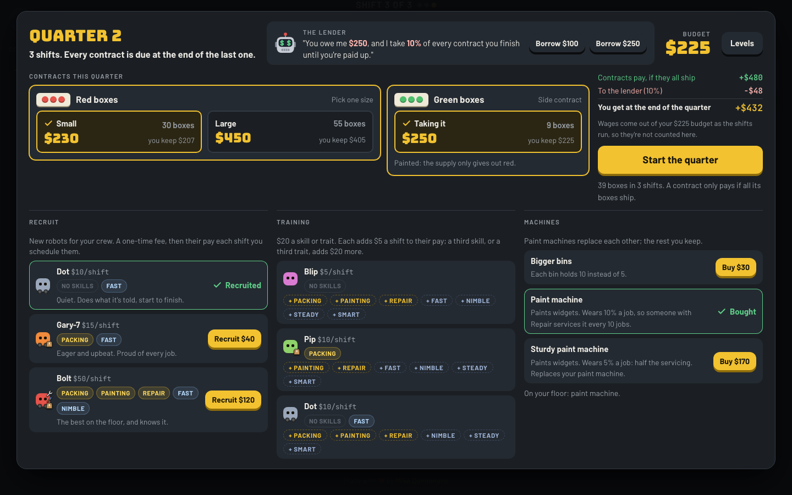
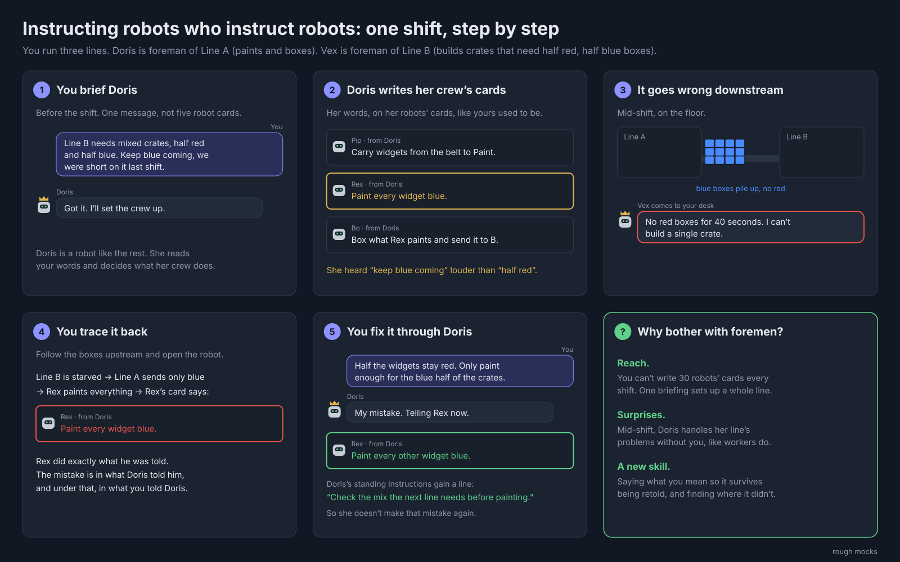

# Progression design

Status: **proposal, partly built.** Level 7, "Your business", is a playable prototype of the loop:
a board of contracts each quarter, money carrying over, recruiting, training, machines and a lender
(decisions 53 to 61). This doc is the shape of the long-term game and stays short. Each idea in it,
with detail and open questions, is an entry in [ideas.md](ideas.md). Reasons and evidence are in
[decisions.md](decisions.md). Mocks are rough and live in [`mocks/progression/`](mocks/progression/).

## Principles

- **You never leave the floor.** At every size, the game is giving robots instructions and seeing
  what they do with them. Mike: "When it gets too managerial, it becomes a spreadsheet simulator."
- **No factory building.** New lines drop into pre-wired bays; anything flexible about routing is
  told to a foreman in words. The only thing you build is instructions.
- **You choose your difficulty** by which contracts you take.
- **Delegation comes from scale, not rules.** You can only talk to one robot at a time; a big
  enough factory makes foremen the obvious move.
- **It's a roguelike (probably).** Mike: "This is going to be a roguelike anyway, probably. I don't
  think I'm gonna wanna do game design for a whole career mode." A run is a string of quarters with
  contracts that keep getting harder; between them you get a few choices, not everything. Runs
  are endless: the contracts get crazier until you go under. Mike: "do the typical roguelike thing
  where you keep going and the contracts get crazier and eventually they'll die."
- **Mechanics first, story later.** Story and writing come in the polish phase, once the mechanics
  are settled.

## The game

You run your own small factory business. You start with a little money of your own. The
dollar-eyed robot from the favicon is a **lender**: borrow from him at the board, no interest, and
each loan takes 10% of every contract you finish until it's paid back (two loans, 20%). Your money
is the quarter's budget; wages come out of it as the shifts run.

**The loop (built in level 7):**
1. **Pick contracts** for the quarter from the board: one color in a Small or Large size, and a side
   contract in another color. All of a quarter's contracts are due at its end and never share a
   color, so every box counts for exactly one contract. Take too much and some won't ship in time.
   Before you start, the board shows what the quarter does to your money if everything ships.
2. **Run shifts** on the floor: schedule your crew, give instructions, watch, fix. Wages tick.
3. **Get paid** at the end of the quarter for every contract that shipped in full.

**Reputation (agreed, not built; decision 78).** Three pips. A missed contract loses a whole pip, a
shipped one wins back a third, and Small, Large and side contracts count the same. Reputation sets
the board: with less of it, clients offer smaller quotas for less pay, which gives you room to
recover and train up. At zero no client will sign with you, and the run is over. That's the only
way a run ends.
4. **Shop between quarters**, three choices of each: recruit a robot (a cheap blank one to train,
   a skilled one, or a pricey expert), train skills and traits, buy machines. Borrow if you need to.

**Growth (not built).** Contracts pay for robots, then machines, then a second line that turns the
first one's output into something bigger: Line A paints and boxes, Line B builds mixed crates, Line
C ships. A mistake upstream starves the line downstream.

**Foremen (not built).** Past two lines, you can't keep up talking to every robot, so you promote
one to run a line. You brief the foreman; the foreman writes their crew's instructions, which you
can read on each robot's card. When something breaks, you trace it to what the foreman said and
correct the foreman. Same game, one more robot between your words and the work.

## Biggest open questions

1. **How much reputation moves the board.** A run ends when reputation runs out (decision 78).
   Open: how far quota and pay drop per pip lost, and what happens if you're broke but still
   reputable.
2. **How to scale bigger.** Foremen will be a first-class concept, and there's only room for a few
   of those. Something more flexible may come later; not yet (decision 69).
3. What happens to a contract that's late? (Now: it pays nothing.)
4. What the lender does when you can't pay him back.

The rest are with each idea in [ideas.md](ideas.md).

## How we got here (2026-11-17)

One evening, several shapes: a corporate ladder of ranks under a robot boss (dropped: higher ranks
became a different, managerial game), then one boss and a growing factory with quotas (dropped for
contracts you choose, which are more tycoon), then contracts, equipment and an investor. Building
level 7 turned the investor into a lender you choose to borrow from, dropped the buy-out ending,
and settled on a roguelike. Decisions 38 to 46 and 49 to 62 have each step; the dropped ideas are
listed with reasons at the bottom of [ideas.md](ideas.md).
